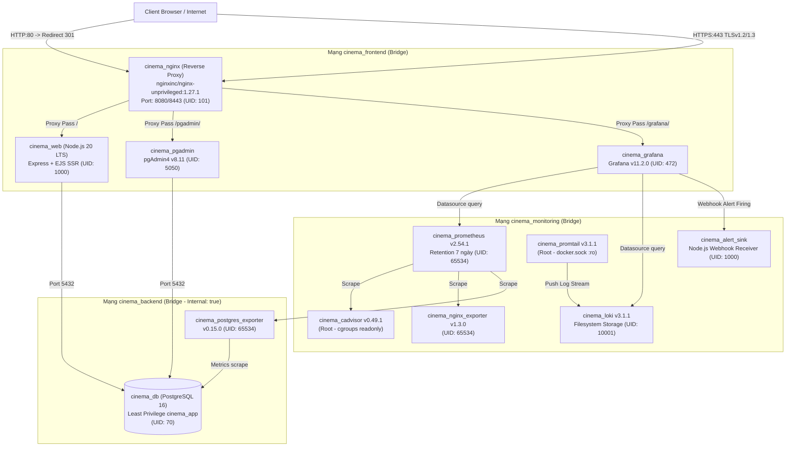

# Hệ Thống Đặt Vé Xem Phim & Sự Kiện Trực Tuyến (Cinema & Event Booking DevOps)

> **Học phần:** Triển khai và Quản trị Hệ thống Phần mềm  
> **Sinh viên:** Đoàn Ngọc Mạnh  
> **Mã sinh viên:** DTC245180048  
> **Repository:** `He_thong_dat_ve_xem_phim_sk`  
> **Kiến trúc:** 12 Microservices đóng gói bằng Docker Compose v2

---

## 1. Giới thiệu Tổng quan
Hệ thống là một giải pháp hoàn chỉnh cho phép quản lý và đặt vé xem phim/sự kiện trực tuyến, giải quyết bài toán chống trùng ghế (race condition) theo thời gian thực. Hệ thống được đóng gói 100% bằng Docker Compose với kiến trúc vi dịch vụ gồm 12 container, bảo đảm cách ly mạng 3 lớp, bảo mật HTTPS tự ký, giám sát số liệu time-series qua Prometheus & Grafana, quản lý log tập trung qua Loki & Promtail, và tự động kích hoạt cảnh báo an toàn thông tin khi xảy ra tấn công dò quét mật khẩu.

---

## 2. Sơ đồ Kiến trúc Hệ thống (System Architecture)



---

## 3. Yêu Cầu Hệ Thống (Prerequisites)
- **Hệ điều hành:** Windows 10/11 64-bit (chạy Docker Desktop với WSL2 Ubuntu-22.04 LTS backend) hoặc Linux (Ubuntu 22.04/24.04).
- **Docker Engine:** Phiên bản `>= 24.0` (Khuyến nghị Docker v27.x).
- **Docker Compose:** Docker Compose CLI v2 (`docker compose version` `>= 2.20`).
- **Phần cứng tối thiểu:** 4 Cores CPU, 8 GB RAM, 10 GB dung lượng đĩa trống.

---

## 4. Hướng Dẫn Cài Đặt Và Khởi Động "Bằng Một Lệnh"

### Bước 4.1: Tải mã nguồn về máy
```bash
# Mở terminal WSL2 Ubuntu-22.04
git clone https://github.com/manhci/He_thong_dat_ve_xem_phim_sk.git ~/cinema
cd ~/cinema
```

### Bước 4.2: Khởi tạo tệp biến môi trường `.env`
Sao chép tệp mẫu và chỉnh sửa nếu cần (các mật khẩu mặc định an toàn đã được chuẩn bị sẵn):
```bash
cp .env.example .env
chmod 600 .env
```

### Bước 4.3: Sinh chứng chỉ SSL/TLS tự ký (Self-Signed Certificate)
```bash
chmod +x nginx/gen-cert.sh
./nginx/gen-cert.sh
```
*Ghi chú:* Script tự động sinh `nginx/certs/server.key` và `nginx/certs/server.crt` với Subject Alternative Name (SAN) cho `localhost` và `127.0.0.1`.

### Bước 4.4: Khởi động toàn bộ 12 dịch vụ
```bash
docker compose up -d --build
```
Kiểm tra trạng thái sẵn sàng (chờ khoảng 15-20 giây cho healthcheck hoàn tất):
```bash
docker compose ps
```
*Tất cả 12 container phải ở trạng thái `Up (healthy)` hoặc `Up`.*

---

## 5. Bảng Địa Chỉ Truy Cập Dịch Vụ & Tài Khoản Mẫu

| Dịch vụ | Giao thức / Cổng | Đường dẫn URL | Tài khoản đăng nhập | Mật khẩu |
|---|:---:|---|---|---|
| **Ứng dụng Web Đặt vé** | HTTPS (443) | `https://localhost/` | `admin` *(Quản trị viên)*<br>`nhanvien01` *(Soát vé rạp)*<br>`khach01` *(Khách hàng)* | *Xem trong tệp `.env` (`ADMIN_PASSWORD`, v.v.)*<br>*(Mặc định trong seed CSDL)* |
| **Giao diện CSDL pgAdmin**| HTTPS (443) | `https://localhost/pgadmin/` | `admin@cinema.local` | *Xem trong tệp `.env` (`PGADMIN_DEFAULT_PASSWORD`)* |
| **Hệ thống Giám sát Grafana**| HTTPS (443) | `https://localhost/grafana/`| `admin` | *Xem trong tệp `.env` (`GRAFANA_ADMIN_PASSWORD`)* |
| **Chuyển hướng HTTP** | HTTP (80) | `http://localhost/` | Tự động Redirect 301 sang HTTPS | - |
| **Cổng dịch vụ nội bộ** | 3000, 5050, 5432, 8080, 9090, 9113, 9187, 3100, 5001 | Đã cô lập trong mạng nội bộ Docker | - | *Không mở ra ngoài máy host* |

---

## 6. Hướng Dẫn Sử Dụng Ứng Dụng Theo Vai Trò (Roles)

### 6.1. Vai trò Khách hàng (`customer` - tài khoản `khach01`)
1. Truy cập `https://localhost/login`, đăng nhập với tài khoản `khach01`.
2. Tại trang chủ `https://localhost/`, chọn phim muốn xem và nhấn **Xem Chi Tiết & Đặt Vé**.
3. Chọn suất chiếu mong muốn $\rightarrow$ Giao diện sơ đồ ghế hiển thị trực quan theo thời gian thực (ghế Đã bán màu đỏ, ghế Trống màu xanh, phân loại ghế Thường, VIP, Đôi).
4. Nhấn chọn ghế $\rightarrow$ Hệ thống thực hiện khóa bi quan và tạo đơn đặt vé trạng thái `PENDING_PAYMENT`.
5. Xác nhận thanh toán $\rightarrow$ Đơn hàng chuyển sang `PAID`, hệ thống tự động sinh vé điện tử kèm **Mã phản hồi nhanh (QR Code)** chứa mã vé duy nhất.

### 6.2. Vai trò Nhân viên Soát vé (`staff` - tài khoản `nhanvien01`)
1. Đăng nhập với tài khoản `nhanvien01`.
2. Truy cập trang Soát vé tại `https://localhost/staff/checkin`.
3. Nhập mã vé (hoặc quét mã QR từ điện thoại của khách hàng) $\rightarrow$ Nhấn **Xác Nhận Soát Vé**.
4. Hệ thống kiểm tra tính hợp lệ và cập nhật trạng thái vé thành `CHECKED_IN` (ngăn chặn tình trạng một vé sử dụng 2 lần).

### 6.3. Vai trò Quản trị viên (`admin` - tài khoản `admin`)
1. Đăng nhập với tài khoản `admin`.
2. Truy cập Bảng điều khiển Quản trị tại `https://localhost/admin/dashboard`.
3. Quản lý Sự kiện / Phim (`/admin/events`): Thêm phim mới, upload poster ảnh (định dạng WebP, PNG, JPEG với dung lượng tối đa 2 MB). Thư mục `/app/public/uploads` tự động lưu trữ ảnh an toàn.
4. Quản lý Suất chiếu (`/admin/showtimes`): Thêm khung giờ chiếu mới, thiết lập giá vé theo loại ghế.

---

## 7. Giám Sát Metrics, Truy Vấn LogQL Và Kịch Bản Cảnh Báo An Toàn

### 7.1. Xem Dashboards Giám sát trong Grafana
Truy cập `https://localhost/grafana/` và mở menu **Dashboards**:
- **Cinema - Containers:** Theo dõi mức sử dụng CPU, RAM, Network I/O thời gian thực của 12 container từ cAdvisor.
- **Cinema - Nginx:** Theo dõi lưu lượng truy cập HTTP/HTTPS, số request/giây, trạng thái kết nối active/waiting.
- **Cinema - PostgreSQL:** Theo dõi số lượng transaction commit/rollback, số connection active và deadlock của CSDL.
- **Cinema - Logs:** Xem dòng log tập trung của toàn bộ container theo nhãn thời gian thực.

### 7.2. Thực thi Truy vấn LogQL trong Grafana Explore
Vào **Explore** $\rightarrow$ Chọn datasource **Loki** và thử nghiệm các truy vấn sau:
- Xem toàn bộ log của ứng dụng web: `{job="webapp"}`
- Lọc các sự kiện đăng nhập thất bại: `{job="webapp"} |= "LOGIN_FAILED"`
- Lọc các phản hồi HTTP lỗi 4xx/5xx trên Nginx: `{job="nginx"} |~ " (4[0-9]{2}|5[0-9]{2}) "`
- Đếm tần suất lỗi đăng nhập trong 1 phút: `sum(count_over_time({job="webapp"} |= "LOGIN_FAILED" [1m]))`

### 7.3. Mô phỏng Tấn công Dò Mật khẩu (Brute Force) & Quan sát Cảnh báo
Dự án cung cấp sẵn kịch bản mô phỏng tấn công để kiểm thử an toàn thông tin:
```bash
# Thực thi script tấn công dò quét 20 mật khẩu sai vào tài khoản admin
./scripts/simulate_bruteforce.sh
```
**Hiện tượng ghi nhận trên hệ thống:**
1. **Phòng vệ Nginx:** Sau 5 request đầu tiên, Nginx kích hoạt Rate Limiter và trả về mã `HTTP 429 Too Many Requests` cho các request tiếp theo.
2. **Ghi vết Log:** Web app ghi nhận chuỗi log `LOGIN_FAILED ip=... user=admin reason=wrong_password` và Promtail đẩy ngay về Loki.
3. **Kích hoạt Cảnh báo:** Sau 1 phút, Grafana Alerting Rule `Cinema - Brute force login` vượt ngưỡng (> 5 lỗi/phút), chuyển trạng thái `FIRING`.
4. **Xử lý sự cố:** Grafana tự động gửi Webhook thông báo sự cố an toàn thông tin tới service `cinema_alert_sink` (kiểm tra bằng lệnh: `docker compose logs alert-sink`).

---

## 8. Danh Sách Các Biện Pháp Hardening Bảo Mật Đã Áp Dụng

1. **Non-root Container:** Tất cả container dịch vụ đều chạy dưới UID không đặc quyền (`nginx`: 101, `web`: 1000, `db`: 70, `prometheus`: 65534, `grafana`: 472, `loki`: 10001, `alert-sink`: 1000). Hai ngoại lệ kỹ thuật bắt buộc (`cadvisor`, `promtail`) được bảo vệ bằng chế độ chỉ đọc `:ro` và cô lập mạng.
2. **Network Isolation:** 3 mạng Docker bridge riêng biệt (`cinema_frontend`, `cinema_backend`, `cinema_monitoring`). Cơ sở dữ liệu nằm trong mạng `backend` có `internal: true`, không publish cổng và không nối ra Internet.
3. **Least Privilege CSDL:** Role `cinema_app` chỉ được cấp quyền `SELECT, INSERT, UPDATE, DELETE`, không có quyền superuser; lệnh tấn công `DROP TABLE` bị PostgreSQL từ chối nghiêm ngặt.
4. **Hạn chế Quyền Container:** Áp dụng `security_opt: [no-new-privileges:true]`, `cap_drop: [ALL]`, giới hạn tài nguyên CPU và RAM tối đa cho từng container.
5. **Security Headers & Cookie Flags:** Nginx bổ sung đầy đủ HSTS, CSP, X-Frame-Options, X-Content-Type-Options; ẩn thông tin phiên bản Nginx (`server_tokens off`); web app ẩn `X-Powered-By` và bật cookie phiên `HttpOnly; Secure; SameSite=Strict`.
6. **Tường lửa Windows:** Dự án chỉ publish duy nhất 2 cổng 80 và 443; tài liệu cung cấp sẵn bộ quy tắc Windows Defender Firewall bảo vệ máy chủ.
7. **Quét Lỗ hổng Trivy:** Công cụ `aquasec/trivy:0.56.2` quét toàn diện image; quy trình `apk upgrade` đã vá triệt để 100% (21/21) lỗ hổng hệ điều hành Alpine (0 CRITICAL, 0 HIGH).

---

## 9. Dừng Và Xóa Hệ Thống (Shutdown & Teardown)

```bash
# 1. Dừng các container nhưng giữ nguyên dữ liệu CSDL và Volumes (Khuyến nghị giải phóng RAM)
docker compose stop

# 2. Khởi động lại sau khi dừng
docker compose start

# 3. Dừng và gỡ bỏ container cùng mạng (Vẫn giữ nguyên dữ liệu Volume)
docker compose down

# 4. Gỡ bỏ hoàn toàn container, mạng và XÓA TOÀN BỘ DỮ LIỆU VOLUMES (Reset sạch)
docker compose down -v
```

---

## 10. Xử Lý Sự Cố Thường Gặp (Troubleshooting)

| Hiện tượng | Nguyên nhân có thể | Cách xử lý |
|---|---|---|
| **Cảnh báo SSL không an toàn trên trình duyệt** | Chứng chỉ HTTPS là chứng chỉ tự ký (Self-Signed) cho môi trường nội bộ/lab. | Nhấn **Advanced (Nâng cao)** $\rightarrow$ **Proceed to localhost (Tiếp tục truy cập)**. |
| **Lỗi `bind: address already in use` cổng 80/443** | Đang có tiến trình khác (IIS, Apache, Skype, Nginx cũ) chiếm cổng 80 hoặc 443 trên Windows. | Chạy PowerShell: `Get-Process -Id (Get-NetTCPConnection -LocalPort 80).OwningProcess` để xác định và tắt tiến trình xung đột, hoặc khởi động lại Docker Desktop. |
| **Không tải được dữ liệu CSDL sau khi đổi `.env`** | Volume `cinema_db_data` đã được khởi tạo bằng mật khẩu cũ từ lần chạy đầu tiên. | Chạy `docker compose down -v` để xóa volume dữ liệu cũ và khởi tạo lại theo mật khẩu mới trong `.env`. |
| **Container cAdvisor báo lỗi sysfs** | Docker Desktop trên Windows sử dụng kernel ảo WSL2. | Cấu hình cAdvisor đã được tối ưu tham số `--docker_only=true` và `--disable_metrics=disk,diskIO` để tương thích hoàn toàn. |
